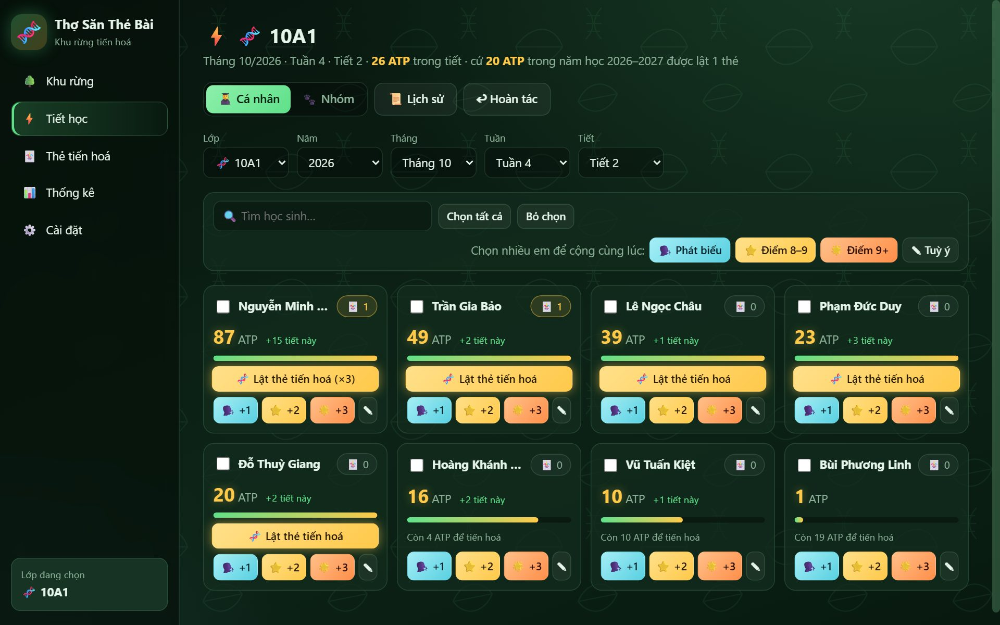

# 🧬 Thợ Săn Thẻ Bài

> Khu rừng tiến hoá — biến mỗi tiết học thành một hành trình tiến hoá.

Ứng dụng quản lý lớp học theo phong cách Sinh học, chạy hoàn toàn trên trình duyệt. Học sinh tích luỹ năng lượng **ATP** qua mỗi lần phát biểu và mỗi điểm cao; đủ mốc ATP thì được lật một **thẻ tiến hoá** để nhận đặc quyền do giáo viên đặt ra.

- **Không cần cài đặt** — mở file là chạy, không có bước build, không có phụ thuộc npm.
- **Không cần mạng** — thư viện và phông chữ đều nằm sẵn trong repo.
- **Dữ liệu nằm trên máy** — lưu bằng SQLite ngay trong trình duyệt, không gửi đi đâu.



## Bắt đầu

**Dùng ngay trên web:** mở <https://anhleviet1603.github.io/Tho-san-the-bai/> bằng Chrome hoặc Edge.

**Tải về để dùng không cần mạng:**

1. Tải file zip của bản mới nhất ở trang [Releases](https://github.com/AnhLeViet1603/Tho-san-the-bai/releases/latest) rồi giải nén.
2. Mở `index.html` bằng **Chrome** hoặc **Edge** để vào ứng dụng.
3. Mở `landing.html` nếu muốn xem trang giới thiệu.

Dữ liệu của bản web và bản tải về nằm ở hai nơi riêng trong trình duyệt. Muốn chuyển qua lại thì xuất file sao lưu ở bên này rồi nhập vào bên kia.

Lần chạy đầu tiên ứng dụng tự tạo cơ sở dữ liệu và 5 thẻ mẫu, và hỏi bạn có file sao lưu để nhập không. Vào **Cài đặt** để tạo lớp và nhập danh sách học sinh.

## Tính năng

| | |
|---|---|
| ⚡ **Cộng ATP một lần bấm** | Phát biểu, điểm 8–9, điểm 9+ hoặc một số tuỳ ý. Chọn nhiều em để cộng cùng lúc, bấm nhầm thì hoàn tác. |
| 🃏 **Thẻ tiến hoá** | Mỗi thẻ là một đặc quyền có hạn sử dụng. Tự đặt tên, nội dung và ảnh cho từng lá. |
| ✨ **Độ hiếm R / SR / SSR** | Mỗi loại thẻ thuộc một cấp độ hiếm, có khung và hiệu ứng lật riêng. Kéo thanh trượt 2 núm trong Cài đặt để chỉnh tỉ lệ ra R / SR / SSR. |
| ✎ **Sửa thẻ của học sinh** | Trong bảng thẻ của từng em: sửa ngày hết hạn, đổi sang loại thẻ khác, hoặc xoá thẻ (có hoặc không trả lại lượt lật). Xoá nhầm thì hoàn tác trong Lịch sử thẻ. |
| 🐾 **Chia nhóm trong tiết** | Chia ngẫu nhiên hoặc kéo thả. Cộng điểm cho nhóm thì mọi thành viên đều nhận ATP. |
| 📊 **Thống kê** | 3 tab con dùng chung bộ lọc (lớp, năm học, tháng, tuần, học sinh): **Tổng quan** (chỉ số chính + bảng xếp hạng), **ATP** (biểu đồ theo loại, lớp, thời gian, nhóm, Top 10), **Thẻ** (thẻ đã lật theo loại và theo độ hiếm, theo lớp và từng học sinh). |
| 📥 **Nhập từ Excel** | Chọn file `.xlsx` / `.xls` / `.csv`, chọn cột họ tên, xem trước rồi nhập. Tên trùng được bỏ qua. |
| 💾 **Sao lưu** | Xuất toàn bộ dữ liệu ra một file `.sqlite`, nhập lại trên máy khác — hoặc bật **tự lưu ra file** để ứng dụng tự ghi sau mỗi thay đổi. Nhắc sao lưu khi quá 7 ngày. |
| 📸 **Bản chụp tự động** | Chụp lại dữ liệu mỗi ngày và trước mọi thao tác thay toàn bộ dữ liệu; khôi phục trong Cài đặt → Dữ liệu › Bản chụp. |
| 🗑 **Thùng rác** | Xoá lớp, học sinh, loại thẻ là chuyển vào thùng rác; khôi phục được với đủ ATP và thẻ. |
| 📜 **Nhật ký thao tác** | Ghi lại các lần xoá, sửa, hoàn tác và đổi cài đặt để tra lại khi có thắc mắc. |

## Luật chơi

1. **Săn ATP** — phát biểu và đạt điểm cao để nhận năng lượng. Điểm của nhóm cũng tính cho từng em.
2. **Chạm mốc** — cứ đủ một mốc ATP trong năm học, học sinh có thêm một lượt lật thẻ.
3. **Lật thẻ** — chọn một trong các thẻ đang úp. Mỗi lá úp có thể là R, SR hay SSR theo tỉ lệ giáo viên đặt; các lá trông giống hệt nhau cho tới khi lật.
4. **Dùng đặc quyền** — từ tuần kế tiếp, giáo viên bấm vào thẻ của em để sử dụng. Thẻ quá hạn tự biến mất.

Mỗi loại thẻ chỉ giữ tối đa một lá. Sang năm học mới, ATP tính lại từ đầu (dữ liệu cũ vẫn còn trong thống kê).

Giá trị mặc định, đều chỉnh được trong **Cài đặt**:

| Thiết lập | Mặc định |
|---|---|
| ATP cho một lần phát biểu | 1 |
| ATP cho điểm 8–9 | 2 |
| ATP cho điểm 9+ | 3 |
| Mốc ATP để lật thẻ | 50 |
| Số thẻ úp mỗi lần lật | 3 |
| Hạn dùng thẻ | 30 ngày |
| Tỉ lệ độ hiếm R / SR / SSR | 70% / 25% / 5% |

## Dữ liệu và sao lưu

Dữ liệu được lưu bằng SQLite ([sql.js](https://github.com/sql-js/sql.js)) và ghi bền vào IndexedDB của trình duyệt, dưới tên `tho-san-the-bai`. Dữ liệu gắn với **trình duyệt và hồ sơ người dùng** trên máy đó.

Ứng dụng tự bảo vệ dữ liệu bên trong trình duyệt:

- **Một tab ghi** — mở ở tab thứ hai thì tab đó chờ, không ghi đè lên nhau.
- **Lưu đáng tin** — thanh bên báo "Đã lưu"; lưu lỗi thì tự thử lại; đóng tab khi còn thay đổi chưa lưu thì trình duyệt hỏi lại.
- **Bản chụp tự động** (5 bản gần nhất) và **kiểm tra dữ liệu lỗi** mỗi lần mở.

### Khi nào dữ liệu có thể mất

Bản chụp tự động nằm **cùng chỗ** với dữ liệu, nên những trường hợp sau làm mất cả hai:

- Xoá dữ liệu duyệt web có tick **Cookie và dữ liệu trang web**, hoặc bật tuỳ chọn **xoá dữ liệu khi đóng trình duyệt**.
- Dùng cửa sổ **ẩn danh / InPrivate** hoặc hồ sơ **Khách**.
- **Máy dùng chung** bị đóng băng (Deep Freeze) hoặc tự reset tài khoản khi khởi động lại.
- Cài lại Windows, xoá tài khoản Windows, gỡ trình duyệt kèm xoá dữ liệu.
- Ổ đĩa gần đầy mà trình duyệt chưa cho phép lưu bền vững (Cài đặt → Dữ liệu báo ⚠ nếu chưa được phép).

Vì vậy hãy giữ **một bản ngoài trình duyệt**:

- **Tự lưu ra file** (Chrome / Edge trên máy tính): Cài đặt → Dữ liệu › Sao lưu → "Chọn file để tự lưu". Nên đặt file trong thư mục **OneDrive / Google Drive** hoặc trên **USB**; mỗi máy một file. Trình duyệt có thể hỏi lại quyền ghi mỗi lần mở — bấm nút "📁 Bấm để tiếp tục tự lưu ra file" ở thanh bên.
- Hoặc **xuất file `.sqlite`** định kỳ; ứng dụng nhắc khi quá 7 ngày chưa sao lưu.

Mất dữ liệu trong trình duyệt thì mở ứng dụng, chọn **"Nhập file sao lưu"** ở hộp chào (hoặc Cài đặt → Dữ liệu › Sao lưu) rồi chọn file sao lưu hay file tự lưu.

File sao lưu chứa tên học sinh thật — `.gitignore` đã chặn `*.sqlite` để tránh đưa nhầm lên repo.

## Cấu trúc thư mục

```
index.html          Ứng dụng chính
landing.html        Trang giới thiệu
css/                Giao diện (base, theme-forest, components, views, landing)
js/
  app.js            Khởi động ứng dụng
  version.js        Số phiên bản hiện ở footer
  core/             db (SQLite + IndexedDB, nâng cấp dữ liệu, bản chụp), tab-lock (một tab ghi),
                    file-sink (tự lưu ra file), router (hash), store, time, ui
  data/             Truy vấn theo miền: lớp, học sinh, tiết, ATP, thẻ, tiến hoá, nhóm, thống kê,
                    integrity (kiểm tra dữ liệu lỗi), audit (nhật ký thao tác)
  features/         Cộng ATP, lật thẻ, chọn học sinh, nhập Excel, sao lưu
  views/            Các màn hình: rừng, tiết học, nhóm, thẻ bài, thống kê, cài đặt
assets/             Phông Be Vietnam Pro và ảnh chụp màn hình
vendor/             sql.js, SheetJS (xlsx), Chart.js — bản offline
tests/              Test đơn vị, test giao diện và trang thử tay (tests/manual)
```

Mã nguồn là JavaScript thuần, không dùng framework hay bundler. Các file được nạp bằng thẻ `<script>` theo thứ tự trong `index.html` và gắn vào không gian tên chung `window.TSTB`.

## Kiểm thử

Cần [Node.js](https://nodejs.org/) (đã chạy với Node 22 — bản CI dùng — và Node 26); không cần `npm install`.

```bash
# Test đơn vị: lớp dữ liệu chạy trong Node với SQLite trong bộ nhớ
node --test "tests/unit/*.test.js"

# Test giao diện: điều khiển Edge/Chrome headless qua DevTools Protocol
node tests/ui/run-ui.mjs
node tests/ui/landing-ui.mjs
node tests/ui/tab-lock-ui.mjs
node tests/ui/save-ui.mjs
node tests/ui/rules-ui.mjs
node tests/ui/file-sink-ui.mjs
node tests/ui/backup-ui.mjs
node tests/ui/stats-ui.mjs
node tests/ui/rarity-ui.mjs

# Thử tay quyền ghi file (hộp hỏi quyền không tự động hoá được): mở tests/manual/fs-probe.html
```

Test giao diện tự tìm Edge hoặc Chrome ở đường dẫn cài đặt mặc định; nếu trình duyệt nằm chỗ khác, đặt biến môi trường `BROWSER_PATH`. Test dùng hồ sơ trình duyệt tạm nên không đụng tới dữ liệu thật.

## Phát hành

Lịch sử thay đổi nằm ở [CHANGELOG.md](CHANGELOG.md). Để ra một bản mới:

1. Sửa số trong `js/version.js` và thêm mục `## [x.y.z] - ngày` vào `CHANGELOG.md`, rồi commit và push.
2. Tạo và push tag trùng số đó: `git tag v1.2.0 && git push origin v1.2.0`.

GitHub Actions (`.github/workflows/release.yml`) sẽ chạy test, đóng zip và tạo release kèm file zip.

Bản trên web được cập nhật riêng: mỗi lần push lên `master`, `.github/workflows/pages.yml` chạy test rồi đưa ứng dụng lên GitHub Pages.

## Giấy phép

Mã nguồn dùng giấy phép [MIT](LICENSE): được tự do dùng, sửa và chia sẻ lại.

Thành phần bên thứ ba giữ giấy phép riêng:

- Phông chữ **Be Vietnam Pro** — SIL Open Font License, xem `assets/fonts/OFL.txt`.
- **sql.js**, **SheetJS** và **Chart.js** trong `vendor/` thuộc giấy phép của từng dự án.
